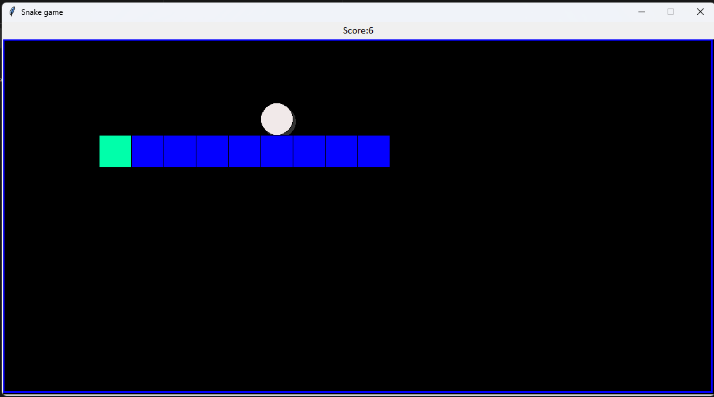

# Snake Game (Python + Tkinter)

A classic Snake game built from scratch in Python using Tkinter, with persistent high scores, dynamic difficulty scaling, and a packaged standalone executable.

## Features

- Classic Snake gameplay - smooth grid-based movement, keyboard controls (arrow keys)
- Persistent leaderboard - top 5 all-time high scores saved locally using JSON, so scores survive closing and reopening the game
- Dynamic difficulty scaling - the snake speeds up as your score increases, keeping the game challenging
- Play Again flow - restart instantly after a game over without relaunching the app
- Visual polish - distinct head coloring, food shadow effect, and a bordered play area
- Packaged as a standalone .exe - playable without installing Python

## How to Run

Option 1: Run the standalone executable - download Snake_Game.exe from the repo and double-click to play, no installation needed.

Option 2: Run from source - clone this repo, then run: python Snake_Game.py
Requires Python 3.x (Tkinter is included by default with most Python installations).

## Controls

- Arrow keys - change direction
- Eat the food to grow and score points
- Avoid hitting the walls or your own body

## What I Learned

This project started as a simple Tkinter exercise and became a deeper dive into:
- Managing game state cleanly (score, direction, speed) across resets
- File I/O and JSON for persistent data storage
- Debugging real issues like merge conflicts and duplicate logic during iterative feature development
- Packaging a Python application into a distributable executable with PyInstaller

## Tech Stack

- Python 3
- Tkinter (GUI/canvas rendering)
- JSON (score persistence)
- PyInstaller (packaging)
